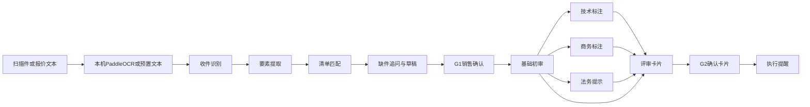

# 合同录入与合同评审：演示落地方案

> 日期：2026-10-27｜内部实施稿，非对外披露
> 依据：[`v3/`](../v3/解决方案.md) 的评审链、[`v3/scripts/`](../v3/scripts/README.md) 的注入结果；录入链沿用 [`v2/`](../v2/解决方案.md)；进件纪律沿用 [`v1/`](../v1/解决方案.md)
> 边界：雨中情与 Agent Forge 无公开可证的签约或合作关系。本文演示数据全部虚构，不构成客户合同、效益承诺或已上线能力。

## 一、要演示什么

给客户交流做两条可在控制台点跑的协作。录入对应合同创建；评审对应 V3 的基础初审加上技术、商务、法务检索标注。不接销售易，不定责，不盖章，不建单。

| 协作 | 自动完成 | 人工闸门 |
| --- | --- | --- |
| 合同录入 | 报价单或扫描件进件，字段预填并带来源，物料清单给出 Top-3，缺字段列出追问 | **G1**：销售逐项确认后，草稿才落账。首场仍全量确认 |
| 合同评审 | 基础初审复算产品、价格、交期、付款比例、行金额和签收；其后只按命中的技术、商务、法务条目标注；同一张卡按环节汇编；最后给三行执行提醒 | **G2**：人工确认后，评审卡片才落账。执行提醒不写回 |

评审卡片不输出「可签 / 不可签」，也不建议签署。技术标注不判定方案合格。商务标注不判断授权是否超限。法务提示不定责。

本次不做：知识问答、销售易读写、用印与建单、把执行提醒做成发货或补充协议流程。V3 方案里技术、商务、法务各有一次确认（G3–G5），法务定责仍在人。首场把这几段收成一条固定顺序的流水线，只在卡片写回处停一次，避免现场主管模型跑偏。

## 二、相对上一版演示改了什么

上一版演示按 V2 做「区域初审」：三单比对、结算复算、签收核对、一张红黄绿卡片。条款只做缺失提示，不进条款改写。V3 把这一段改名为「合同评审」，在规则复算之后接上三份检索语料。

- **基础初审仍是规则岗。** 付款合计、行金额、收货地址继续由 `check_payment`、`check_amounts`、`check_delivery` 出数。模型只引用返回值。
- **技术、商务、法务是标注岗，不是决策岗。** 三岗按顺序检索 `v3-corpus`，只写命中条目。依据要求合同写、正文没写的，结论是待补。没有条目编号的题不上卡。不各开一套并行审阅员，也不把模型补写的国标、法条或历史意见当成检索结果。
- **卡片按层汇编。** 基础初审、技术、商务、法务只收上游已经写出的行，写在同一张 `评审卡片.md` 里，一次 `upsert_review_card` 落账。不附未覆盖项清单。
- **执行提醒只占最后一环。** 发货排产、补充协议、退换货各写一行，标明方案仍在细化，不调用写回工具。V3 的 POC-2 正文把执行与变更放在本 POC 之外；演示只保留这三行提醒，不把它当成已设计的执行流程。

录入链不改：收件、提取、清单 Top-3、缺件追问、G1。扫描件仍走 OCR，服务不可用时回退预置文本。初审读取的仍是录入后的案例，两条协作用案例号衔接，不合成一条超长链。

对外口径不变：不报效率倍数，不报省下多少钱。V3 综述里的分钟数和单量三档只留在内部假设。销售易、30 分钟、50 单/天若被问到，回答「来自交流口径，待现场核对」。

## 三、两条协作怎么编排

录入用串行接力（`pipeline`）。四环按 `order` 依次执行，上一步产物自动挂到下一步，全部跑完即交付。此模式不能再声明 `needs`，也不能打回重做。

评审用主管监督制（`supervisor`）。岗位和依赖写在协作契约里，不改运行时调度。基础初审没有上游。技术、商务、法务都只依赖基础初审，所以同一波并行。卡片依赖基础初审和这三份。执行提醒依赖卡片。主管第一次必须把六个执行岗一次列入作业单，每波对照验收标准通过后放行下一波。各岗只交契约点名的那一个文件，多出来的文件验收不通过。

录入不改成并行。要素提取依赖收件原文，清单匹配依赖抽出的报价行，缺件追问依赖提取和匹配。



录入协作跑到 G1。评审协作从已确认草稿，或演示员指定的案例号，跑到执行提醒。G2 在卡片写回；执行提醒不再等人批。

## 四、岗位与交付物

交接落成给销售或评审人看的 Markdown。预填单每一项写：字段、预填值、出处（报价哪一行或合同哪一句）、待确认。评审卡每一项写：事项、结论（通过 / 不通过 / 待补）、一句话说明、依据名称（可附条目编号）。没有出处不填值，没有条目编号不写这一行。正文不写工具名、参数名和置信度。首场仍逐项人工确认。

### 4.1 雨中情-合同录入

模式 pipeline。1 个主管占位 + 4 个执行岗。主管只负责审计口径，不改单据。`max_rounds` 为 3。

| 顺序 | 岗位 | 做什么 | 交付物 |
| --- | --- | --- | --- |
| 1 | 收件识别 | 登记附件是否齐全。扫描件走 OCR，机读报价单直接读文本 | `收件识别.md` |
| 2 | 要素提取 | 抽出客户、项目、金额、付款比例、账期、收货、质保。每项写预填值和出处 | `要素提取.md` |
| 3 | 清单匹配 | 报价行对物料别名，给出已匹配、未匹配、Top-3 | `清单匹配.md` |
| 4 | 缺件追问 | 汇总缺口，起草表单，调用写回工具等人批 | `填单草稿.md` |

验收口径：把猜测写进正式字段即不合格；写回必须经过人工批准。交付物不写工具名和置信度。`start_prompt` 写死案例号，例如「案例 YZQ-2026-003，按契约跑完，写回须人批」。

### 4.2 雨中情-合同评审

模式 supervisor。1 个主管 + 6 个执行岗。`max_rounds` 为 4。作业标准是 `yuzhongqing-contract-review-v3-runbook`。依赖写在成员契约上：基础初审无上游；技术、商务、法务只依赖基础初审；卡片依赖这四份；执行提醒依赖卡片。各岗只交下表那一个文件。

| 波次 | 岗位 | 依赖 | 做什么 | 交付物 |
| --- | --- | --- | --- | --- |
| 1 | 基础初审 | 无 | 对照报价、合同、签收。产品、价格、交期、付款比例、行金额、地址用白话写复算结果 | `基础初审.md` |
| 2 | 技术标注 | 基础初审 | 只查合同里的品名和项目名。只写有条目编号的行，不判定方案合格 | `技术标注.md` |
| 2 | 商务标注 | 基础初审 | 付款、赔偿、违约、宽限期。没有条目编号的行不写，不判断是否超权限 | `商务标注.md` |
| 2 | 法务提示 | 基础初审 | 只写命中条目。标准号没写则待补，说明里可带一句具体标准号无法判断。不定责 | `法务提示.md` |
| 3 | 分层卡片 | 基础初审、技术、商务、法务 | 等这四份都到齐，只汇编上游已有行，不附未覆盖项 | `评审卡片.md` |
| 4 | 执行提醒 | 评审卡片 | 发货排产、补充协议、退换货各一行。不调用写回工具 | `执行提醒.md` |

## 五、工具边界

演示包不进默认配置，只注入指定租户，其它租户看不见。MCP 名 `yuzhongqing-poc-contract`。

读数和规则复算由工具完成，模型只抽取和写说明。条款结论只引用 `search_rule` 返回的条目。

- **读：** `list_cases`、`get_case`、`get_quote`、`get_receipt`、`search_material`、`search_rule`
- **检索：** `search_rule` 的 `collection` 取语料文件名（不含 `.md`）。按二级标题切条目，命中只返回该条目，未命中返回空列表，不回退文首。默认目录 `v3-corpus`：`payment-rules`、`delivery-rules`、`clause-hints`、`tech-rules`、`biz-rules`、`legal-rules`。省略 collection 则搜全部。要退回旧规则，启动前设 `YUZHONGQING_CORPUS_DIR=v2-corpus`。物料别名 `materials.json` 固定从 `v2-corpus` 读，不随检索目录切换。
- **OCR：** `ocr_attachment`。图片存在且 `OCR_SERVICE_URL` 可达时，POST 到本机服务，默认 `http://127.0.0.1:18088/ocr/parse-question-image-upload`。本机 8088 被 Airflow 占用，所以雨中情启动脚本改听 18088。服务不可用时回退该案例已备好的识别文本，结果标明 `source=fixture`。
- **规则（不经模型）：** `match_lines`（别名表 + Top-3）、`check_payment`（比例合计与 100% 的差额）、`check_amounts`（数量 × 单价）、`check_delivery`（合同收货信息与签收单）
- **写（须人工确认）：** `upsert_contract_draft`、`upsert_review_card`。只写内存，进程退出即消失。不提供审批通过、用印、建单工具。

## 六、模拟数据

客户未提供合同范本、历史案例或相关文档。三份合同全部虚构，甲方使用「高陵城更示范项目部」一类假名。每份文首标注「演示虚构，非雨中情合同」。物料别名约 15–20 条，同一物料保留「销售口头叫法 / 规格描述 / 内部编码」三列，正式项目须由客户主数据责任人确认。

`v3-corpus` 里的技术、商务、法务条目同样是演示假设，不是客户制度，也不是国家标准或法条全文。卡片上出现的修改建议必须能对上条目编号，例如 `TEC-PU-2`、`BIZ-PAY-100`、`LAW-WAR`。

| 案例号 | 用途 | 埋点 |
| --- | --- | --- |
| `YZQ-2026-001` | 规则干净单 | 比例 30+60+10=100，名称能唯一命中，签收一致，质保 5 年已写明。基础初审应通过。赔偿、违约、标准号、宽限期若依据有条目且正文没写，标待补；依据没有的题不上卡。不把这张单说成「条款也全绿」 |
| `YZQ-2026-002` | 叫法不一致 | 报价写「SBS 3mm 聚酯胎」，主数据是「弹性体改性沥青防水卷材 SBS I 型 3mm」。只给 Top-3，不自动落编码 |
| `YZQ-2026-003` | 主演示异常单 | 预付 20 + 到货 50 + 验收 20 + 质保 15 = 105；合同收货地址与签收单不一致；质保期缺失；项目为屋面补强，货物含双组分聚氨酯和非固化，正文未写施工条件。录入追问质保期。评审卡用白话写加总 105 和地址不一致。技术应出现 `TEC-PU-2`、`TEC-NCR`、`TEC-ROOF`。商务可引用 `BIZ-PAY-100`、`BIZ-CASE-105`、`BIZ-GRACE`。法务可引用 `LAW-WAR`、`LAW-PAY`；具体标准号无法判断只作为法务一行里的说明，不单独铺成清单。另附首页扫描图供现场 OCR |

扫描图由 `python3 script/render_scan.py` 把虚构合同首页渲染成中文印刷体 PNG。演示前将该图跑一遍 OCR，把 `raw_text` 存进 `ocr-fallback.md`。

## 七、OCR 接法

复用本机已有的 PaddleOCR 服务，不把模型权重打进 runtime 镜像。参考实现在 `/home/pan/work/math/github/math-pocket`：上传接口为 `POST /ocr/parse-question-image-upload`，健康检查为 `GET /health`。雨中情脚本听 `127.0.0.1:18088`，启动脚本在 `v2/scripts/ocr/`。

- 本机先确认 OCR `/health` 就绪。
- runtime 用 `bun run dev` 时，MCP 进程可以直接访问 `127.0.0.1:18088`。
- Docker 演示时，容器内的 `127.0.0.1` 不是宿主机，须把 `OCR_SERVICE_URL` 指到宿主机地址。首场优先本机 dev，不把 OCR 可用性绑在云上镜像。
- OCR 只出草稿。模型只做字段结构化。人确认后才写草稿。演示默认不把合同图片送出本机。

## 八、代码落点

演示包在 runtime 仓库 `demos/yuzhongqing-contract/`，不写入 runtime 默认 `agentforge.jsonc`。注入脚本在本文档仓库，只对 `--tenant` 注册。

Runtime：

- `mcp/contract-server.ts`：stdio MCP，`bun:sqlite` 内存库。默认检索 `v3-corpus/`
- `v3-corpus/`：结算、签收、栏目提示，以及技术、商务、法务条目
- `v2-corpus/`：上一版规则；`materials.json` 仍在这里
- `fixtures/cases/`：三份虚构合同；`003` 另附 `scan.png` 和 `ocr-fallback.md`
- `skills/`：录入作业标准，以及 runtime 内保留的 v2 初审作业标准。v3 评审作业标准不覆盖这份，改从 docs 注入

根 `package.json` 的 workspaces 已包含 `demos/yuzhongqing-contract`。镜像构建会复制 `demos`，改语料或 MCP 后需要重新构建。MCP 相对 `packages/opencode` 的启动命令：

```text
bun run ../../demos/yuzhongqing-contract/mcp/contract-server.ts
```

本文档仓库：

- `11-企业客户方案/雨中情/v3/scripts/inject_yuzhongqing_demos.py`：注入「雨中情-合同录入」和「雨中情-合同评审」。`--only intake` 或 `--only review` 可只注一条
- `v3/scripts/skills/`：`yuzhongqing-contract-intake-runbook`、`yuzhongqing-contract-review-v3-runbook`
- `v2/scripts/`：上一版四环初审的注入脚本，保留不删
- 本目录的演示剧本：案例号、口播顺序、预期红灯、禁止对外说的话。实现口径以本文第九节为准

本机注入示例：

```bash
cd 11-企业客户方案/雨中情/v3/scripts
export AGENTFORGE_USER='...'
export AGENTFORGE_PASSWORD='...'
python3 inject_yuzhongqing_demos.py --tenant '<租户>' --base http://127.0.0.1:4196
```

## 九、现场剧本（约 15 分钟）

1. 说明数据是虚构直供合同，系统不代替签署。依据没覆盖的题不在卡片上开。依据要求写、合同没写的，标待补。
2. 打开 `YZQ-2026-003` 扫描页，调一次 OCR，指出识别文本仍须对照原件。
3. 跑「合同录入」：展示带出处的字段、物料 Top-3、质保期追问。在人工确认里通过草稿，**故意不改 105%**，把错误留给评审。
4. 跑「合同评审」：卡片上能看懂付款加总 105、比 100 多 5，以及两处地址不一致。技术行应有聚氨酯、非固化、屋面补强三条，不出现包装储运或「方案是否合格」。卡片按层呈现，没有未覆盖项清单；人点确认。执行提醒只有三行，没有写回。强调没有「建议签署」。
5. 用 `YZQ-2026-001` 快放基础初审通过、物料唯一命中，说明核对不是只会报错。若卡片上出现赔偿或标准号，应是待补，不是一长串无法判断。
6. 收束：正式项目需要客户提供 50–100 份脱敏样本、物料口径责任人、技术/商务/法务条目责任人、销售易只读接口。接口不通就维持「上传附件」这一形态。

对外不说：效率提升倍数、50 单提到 200 单、已签约、OCR 可无人值守入库、演示语料等于客户制度或国标全文。

## 十、验收与实施顺序

这里的验收是演示自身能不能点跑，不是客户 POC 的业务指标。

- 三个案例都能从控制台跑完。人工确认不批准，则草稿和卡片不落账。
- `003` 的付款合计红灯来自 `check_payment` 的数字，不来自模型口述。地址不一致来自 `check_delivery`。
- `003` 的技术、商务、法务修改建议都能对上条目编号。没有编号的行不出现。标准号没写时，只在法务说明里写具体标准号无法判断。卡片正文不出现工具名和参数名。
- `002` 不把 Top-3 的第一条写成已匹配。
- `001` 的付款、行金额、签收没有被演示脚本故意制造的缺口。
- OCR 服务关掉时，`003` 仍能用预先准备的文字跑通，交付物写「这次没识别成，对照的是预先准备的文字」，不写 `source=fixture`。
- 执行提醒没有调用 `upsert_review_card` 或 `upsert_contract_draft`。
- 注入只出现在指定租户。`YUZHONGQING_CORPUS_DIR` 未设置时，`search_rule` 读的是 `v3-corpus`。

核对顺序：

1. 三份虚构合同、别名表、`v3-corpus` 和 `003` 扫描页、OCR 回退文本已在演示包内。规则断言：合计 105 失败，合计 100 通过，地址不一致失败。
2. 用 v3 注入脚本把两条协作写入本机租户，各跑通 `003`。
3. 按第九节走一遍 `003` 全路径（含一次真实 OCR、一次 OCR 关闭回退）和 `001` 的规则通过路径。
